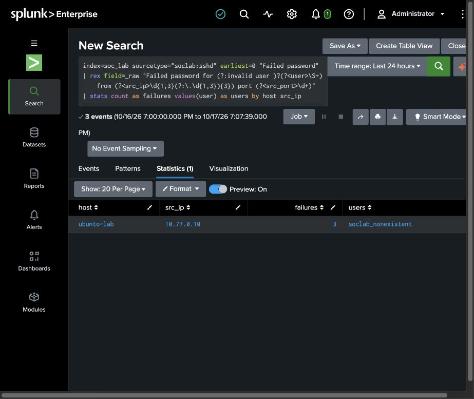
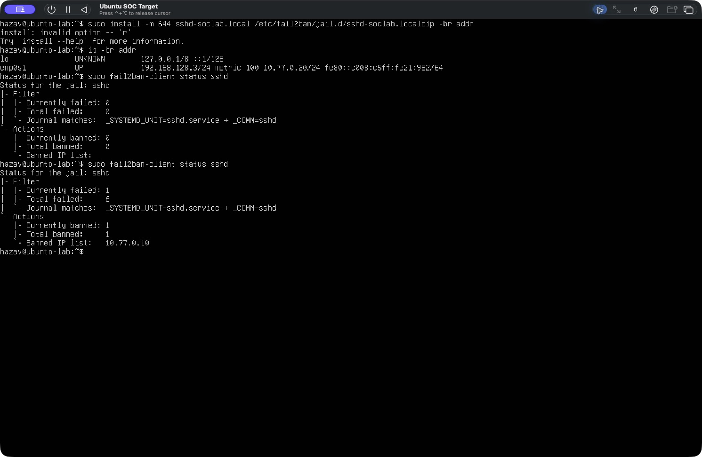
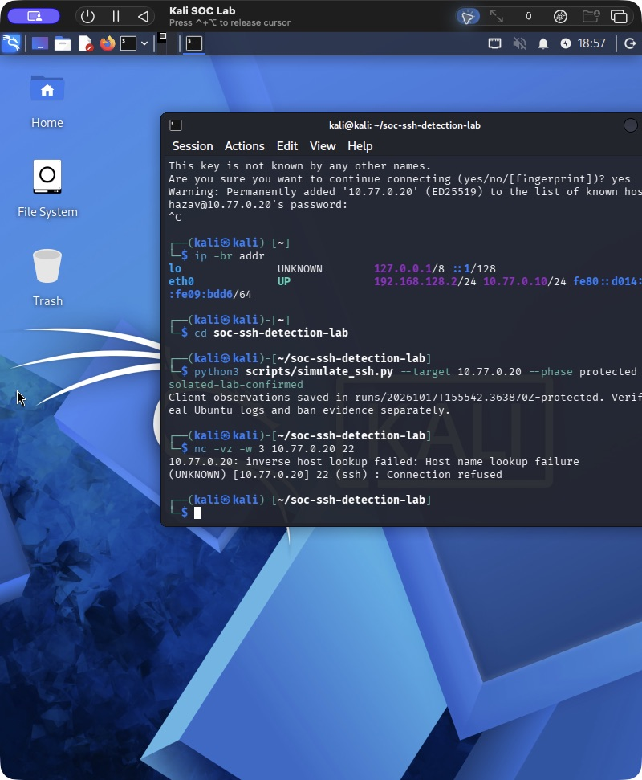
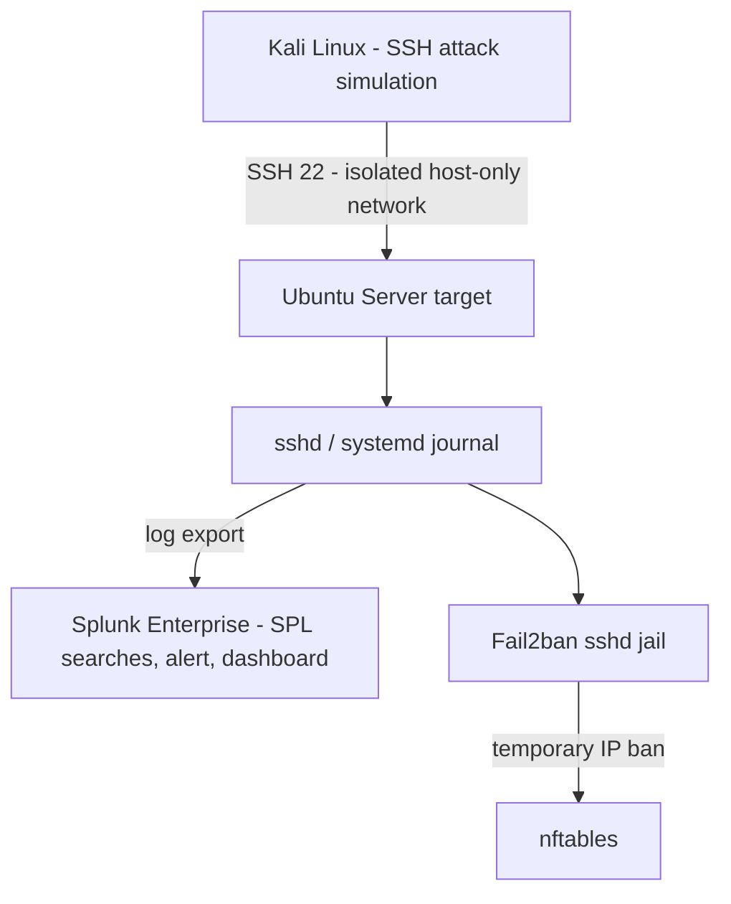

# SSH Brute-Force Detection & Response Lab (Splunk + Fail2ban)

A hands-on SOC lab I built from scratch: **Kali Linux** runs a controlled SSH password-guessing simulation against an isolated **Ubuntu** server. The authentication logs are investigated in **Splunk** (SIEM), and **Fail2ban** automatically blocks the attacking IP with **nftables**.

**Skills shown:** Linux log analysis · Splunk SPL (rex field extraction, stats, threshold detection) · Fail2ban / nftables · isolated lab networking · incident reporting · Python · CI tests

[הסבר בעברית](docs/README_HE.md)

## Results (run on 2026-10-17)

| | Result |
|---|---|
| Attack simulation | Kali `10.77.0.10` → Ubuntu `10.77.0.20`, bounded run with a non-existent user and wrong passwords |
| Detection (Splunk) | 16 SSH journal events ingested; SPL extracted user / source IP / port and found 3 failed-password events from the attacker |
| Response (Fail2ban) | Attacker IP banned after 5 matching events in 60 s; nftables reject rule confirmed; next connection from Kali → `Connection refused` |
| Documentation | Timeline, investigation and limitations in the [incident report](docs/INCIDENT_REPORT.md) |

### Splunk – failed passwords by source IP


### Fail2ban – attacker banned


### Attacker blocked


More screenshots (nftables rule, Fail2ban log, sshd events, Splunk ingestion) are in [`evidence/2026-10-17/`](evidence/2026-10-17/).

## Architecture



Splunk handles detection and investigation; Fail2ban handles the automated host-level response.

## Detection logic (SPL)

Repeated failures from one source within one minute ([all searches](splunk/searches/)):

```spl
index=soc_lab sourcetype="soclab:sshd" "Failed password"
| rex field=_raw "Failed password for (?:invalid user )?(?<user>\S+) from (?<src_ip>\d{1,3}(?:\.\d{1,3}){3}) port (?<src_port>\d+)"
| where isnotnull(src_ip)
| bin _time span=1m
| stats count as failures values(user) as users by _time host src_ip
| where failures >= 5
```

Also included: failure summary by IP, an auth timeline (failed vs. accepted logins), a scheduled alert and a dashboard, packaged as a [Splunk app](splunk/).

## Repository

| Path | Contents |
|---|---|
| `scripts/simulate_ssh.py` | Bounded simulator: only accepts a lab IP in `10.77.0.0/24`, max 12 attempts, fake user |
| `config/` | sshd / Fail2ban lab config |
| `splunk/` | SPL searches, saved alert, dashboard |
| `docs/RUNBOOK.md` | Step-by-step setup and execution |
| `docs/INCIDENT_REPORT.md` | Incident report for the run |
| `tests/` | Unit tests for the simulator's safety limits (run in GitHub Actions) |

Run the tests: `python3 -m unittest discover -s tests -v`

## Environment

Kali 2026.1 and Ubuntu Server 24.04.3 (ARM64) in UTM on Apple Silicon, host-only network with no internet route during the test. Splunk Enterprise 10.6.1.1 on the macOS host, bound to localhost.

## Next steps

- Re-run with more attempts to trigger the Splunk threshold alert and capture the dashboard
- Verify ban expiry and recovery
- Continuous log forwarding (Splunk Universal Forwarder) instead of export

## Safety

Everything runs on my own isolated VMs. The simulator refuses non-lab targets, uses a non-existent username, and does not recover credentials or scan networks.
