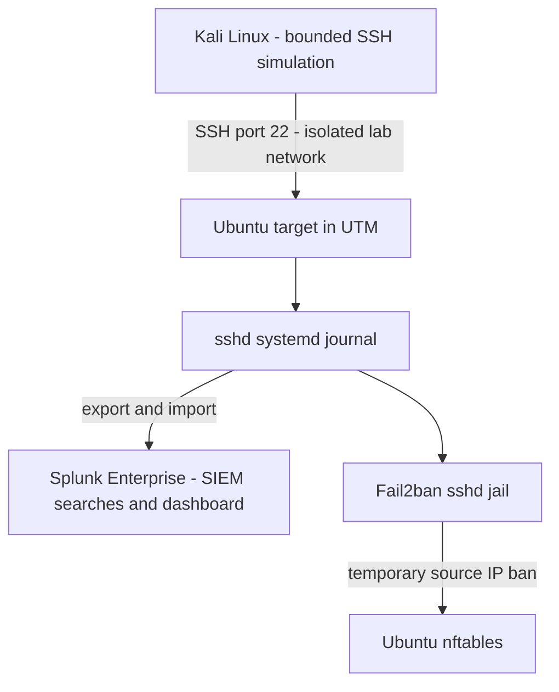

# SSH Detection and Response Lab

A personal SOC learning project: Kali Linux generates a small, controlled SSH password-guessing simulation against an Ubuntu VM in UTM. Ubuntu authentication events are investigated in Splunk, and Fail2ban provides host-level blocking.

**Status: one protected VM simulation and the Fail2ban block were verified; 16 Ubuntu SSH journal events were ingested into Splunk and an ad hoc SPL search returned three failed-password events.** The one-minute alert, dashboard, baseline run and ban-expiry recovery have not been verified yet. The evidence directory records what was run and observed. No successful credential compromise is claimed.

[הסבר בעברית](docs/README_HE.md) · [Worked example](docs/EXAMPLE_WALKTHROUGH.md)

## Architecture

Splunk is the SIEM in this project; it is not a separate tool alongside a SIEM. Splunk detects and supports investigation. Fail2ban reads the target journal and blocks independently. This repository does **not** implement a Splunk-triggered automatic response or Splunk Enterprise Security.

## What this demonstrates after a verified run

- Linux authentication-log investigation and source/user extraction.
- Threshold detection of repeated SSH failures in SPL.
- Correlation of failed and successful authentication events.
- Temporary blocking with Fail2ban and evidence-based verification.
- Incident documentation, limitations, and reproducible lab steps.

## Start here

1. Follow [setup and execution](docs/RUNBOOK.md).
2. Run `python3 -m unittest discover -s tests -v` for local checks.
3. Install the [Splunk search app](splunk/README.md), or paste the SPL searches into Splunk Web.
4. Collect real evidence and complete the [incident report](docs/INCIDENT_REPORT.md).
5. Update [verification status](evidence/STATUS.md) only with actual observations.

## Platform requirement

Kali and Ubuntu ran as ARM64 guests on Apple Silicon. Splunk Enterprise 10.6.1.1 was installed on the Apple Silicon macOS host from Splunk's official ARM64 package. The instance was configured to bind the web and management interfaces to loopback. Splunk Enterprise license and platform terms still apply; this repository does not include a Splunk runtime or credentials.

## Scope

The simulation accepts one IPv4 target on `10.77.0.0/24`, uses a fixed nonexistent lab username and at most 12 generated wrong passwords, and records client results. It refuses other ranges. It does not recover credentials, target public services, or scan networks. A private IP alone does not prove isolation: verify the VM network before running.

## Portfolio wording

Current: **Built an isolated Kali/Ubuntu SSH detection lab, investigated real authentication logs in Splunk, and verified a temporary source-IP block with Fail2ban. Alerting, dashboard, baseline and expiry retest remain in progress.**

After real verification: **Built an isolated Kali/Ubuntu lab, simulated repeated SSH authentication failures, investigated the events in Splunk, and verified temporary source-IP blocking with Fail2ban.**

This is educational hands-on experience, not professional production experience. Hazav should personally execute and explain the workflow before presenting it as a completed personal project.

## References

- [Ubuntu OpenSSH documentation](https://ubuntu.com/server/docs/how-to/security/openssh-server/)
- [Ubuntu Fail2ban documentation](https://help.ubuntu.com/community/Fail2ban)
- [UTM documentation](https://docs.getutm.app/)
- [Splunk Enterprise requirements](https://help.splunk.com/en?resourceId=Splunk_Installation_Systemrequirements)
- [Splunk saved search configuration](https://help.splunk.com/en/splunk-enterprise/alert-and-respond/alerting-manual/9.4/manual-alert-configuration-with-.conf-files/configure-alerts-in-savedsearches.conf)
